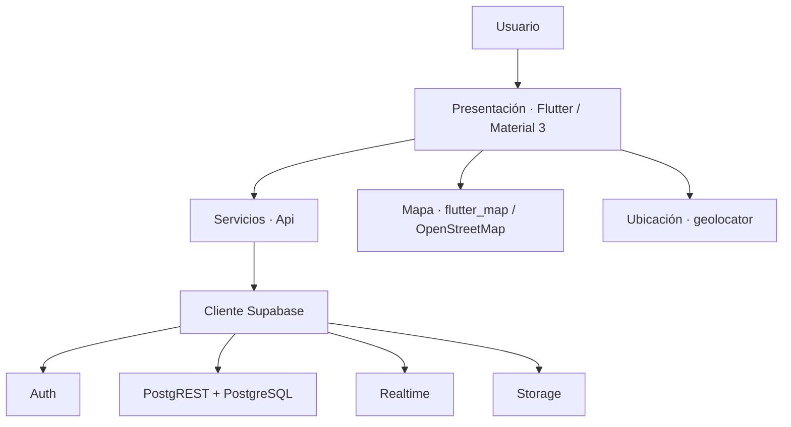
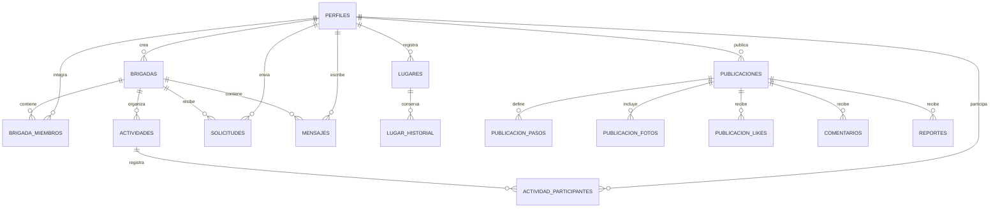

<div align="center">

  " alt="EcoBrigada — Logo oficial" width="240" />

  <h1>EcoBrigada</h1>
  <h3>Plataforma Comunitaria para la Recuperación de Espacios Públicos</h3>

  <p><em>Conectando comunidades para construir espacios públicos más limpios, sostenibles y participativos.</em></p>

  
  
  
  
  
  

  **Proyecto APT · Capstone · Duoc UC, Sede San Andrés de Concepción**

</div>

---

## Índice

1. [Descripción del proyecto](#descripción-del-proyecto)
2. [Problemática y propuesta de solución](#problemática-y-propuesta-de-solución)
3. [Alcance geográfico](#alcance-geográfico)
4. [Funcionalidades](#funcionalidades)
5. [Roles y permisos](#roles-y-permisos)
6. [Tecnologías y dependencias](#tecnologías-y-dependencias)
7. [Arquitectura del sistema](#arquitectura-del-sistema)
8. [Estructura del proyecto](#estructura-del-proyecto)
9. [Modelo de datos](#modelo-de-datos)
10. [Instalación y configuración](#instalación-y-configuración)
11. [Seguridad y trazabilidad](#seguridad-y-trazabilidad)
12. [Pruebas y criterios de aceptación](#pruebas-y-criterios-de-aceptación)
13. [Alcance técnico y limitaciones](#alcance-técnico-y-limitaciones)
14. [Equipo y contribuciones](#equipo-y-contribuciones)
15. [Licencia](#licencia)

## Descripción del proyecto

**EcoBrigada** es una aplicación móvil multiplataforma orientada a la participación ciudadana, la recuperación de espacios públicos y la educación ambiental. Su propósito es facilitar la colaboración entre vecinos y organizaciones comunitarias mediante herramientas de georreferenciación, coordinación de brigadas, comunicación y difusión de prácticas de reciclaje y reutilización.

La aplicación centraliza la información de espacios intervenidos y por intervenir, permite organizar actividades comunitarias y conserva el registro de los cambios realizados. De esta manera, transforma iniciativas ambientales aisladas en acciones coordinadas y trazables.

> **Estado del proyecto:** MVP funcional en desarrollo y validación académica. Las funcionalidades descritas corresponden al alcance implementado en el código base. Las mejoras pendientes se identifican expresamente.

### Objetivo general

Desarrollar una plataforma digital que impulse la recuperación de espacios públicos mediante el registro de zonas que requieren intervención, la coordinación de brigadas de limpieza, el seguimiento de sus actividades y la difusión de conocimientos sobre reciclaje.

### Objetivos específicos

- Centralizar la información geográfica de zonas sucias, espacios recuperados y actividades comunitarias.
- Facilitar la creación, administración y participación en brigadas de limpieza.
- Registrar los cambios de estado de los lugares intervenidos, identificando al usuario y la fecha de cada acción.
- Promover la participación y el aprendizaje ambiental mediante publicaciones de reciclaje y reutilización.
- Proteger las operaciones y datos del sistema con autenticación, autorización y reglas de acceso.
- Proporcionar una solución mantenible y extensible, con separación de responsabilidades y persistencia relacional.

## Problemática y propuesta de solución

La acumulación de residuos en espacios públicos afecta la calidad de vida de las comunidades y el entorno. A menudo, los vecinos desconocen dónde existe una necesidad de limpieza, qué actividades están organizadas o cómo participar. La coordinación mediante canales informales también dificulta conservar un historial de lo realizado.

EcoBrigada aborda esta problemática mediante cuatro ejes:

| Eje | Solución |
| --- | --- |
| Información | Mapa colaborativo con ubicaciones y estados de los espacios públicos. |
| Coordinación | Brigadas, actividades, solicitudes de participación y chat grupal. |
| Trazabilidad | Historial de cambios de estado y registro de decisiones de participación. |
| Educación ambiental | Guías, fotografías y pasos de proyectos de reutilización compartidos por la comunidad. |

## Alcance geográfico

El alcance inicial del proyecto APT se concentra en la Región del Biobío, Chile, específicamente en las comunas de:

- Coronel.
- Concepción.
- Lota.
- San Pedro de la Paz.

Estas comunas definen el alcance territorial del piloto académico. El mapa puede visualizar otras ubicaciones, pero la expansión territorial y la validación en nuevas comunas quedan fuera del alcance inicial.

## Funcionalidades

### 1. Autenticación y perfil de usuario

- Registro con nombre, correo electrónico y contraseña.
- Inicio y cierre de sesión mediante Supabase Auth.
- Confirmación de correo cuando esté habilitada en el proyecto de Supabase.
- Creación automática del perfil asociado a la cuenta mediante un disparador de PostgreSQL.
- Visualización de nombre, correo, puntos acumulados y solicitudes del usuario.
- Consulta pública de información del mapa, las brigadas y las publicaciones disponibles; las operaciones de escritura requieren autenticación.

### 2. Mapa colaborativo y geolocalización

- Visualización cartográfica mediante **OpenStreetMap** y la biblioteca **flutter_map**.
- Registro de lugares con nombre, descripción, latitud, longitud y estado.
- Marcadores diferenciados para lugares sucios, lugares limpios y actividades de brigadas.
- Filtros independientes para cada categoría visible.
- Consulta de detalles de un lugar y de su historial de cambios.
- Geolocalización del dispositivo y centrado del mapa, previa autorización del usuario.
- Selección de la ubicación de una actividad directamente sobre el mapa.
- Actualización de espacios de sucio a limpio y viceversa.
- Acceso a información de las actividades y solicitud de participación.

El mapa utiliza mosaicos cartográficos de OpenStreetMap y muestra la atribución correspondiente. No requiere una clave de Google Maps Platform.

### 3. Brigadas de limpieza

- Creación de brigadas con nombre, comuna, descripción y estado de admisión.
- Listado y búsqueda por nombre o comuna.
- Visualización de integrantes y del rol de cada usuario.
- Asignación automática del rol de administrador al creador de la brigada.
- Configuración de brigadas abiertas o cerradas a nuevas solicitudes.
- Envío de solicitudes de ingreso por usuarios autenticados.
- Aceptación o rechazo de solicitudes por el administrador.
- Consulta del estado de las solicitudes desde el perfil del solicitante.

### 4. Organización de actividades

Cada brigada puede organizar actividades de recuperación de espacios públicos:

- El administrador registra el título, descripción, fecha de inicio y ubicación geográfica.
- Los usuarios consultan las actividades disponibles y pueden solicitar participar.
- El administrador gestiona las solicitudes correspondientes.
- Las actividades admiten los estados **programada**, **en curso** y **finalizada**.
- Las actividades se representan geográficamente en el mapa.
- Las solicitudes aceptadas para una actividad registran al usuario como participante.

### 5. Chat de brigadas en tiempo real

- Conversaciones independientes por brigada.
- Acceso restringido a integrantes autorizados.
- Envío de mensajes de texto con identificación del autor.
- Registro de fecha y hora de envío.
- Actualización de mensajes mediante **Supabase Realtime**.
- Validación de mensajes no vacíos y de hasta 2.000 caracteres.

### 6. Trazabilidad de espacios públicos

El sistema registra automáticamente la creación de lugares y sus cambios de estado. Cada registro contiene:

- Identificador del espacio público.
- Usuario responsable del registro o cambio.
- Estado anterior y nuevo estado.
- Fecha y hora del evento.

La operación de actualización se ejecuta mediante una función SQL que conserva el historial en la misma operación. Esto permite reconstruir la evolución de cada lugar y evita registrar modificaciones redundantes cuando el estado no cambia.

### 7. Publicaciones de reciclaje y reutilización

Espacio comunitario para compartir conocimientos sobre cómo reutilizar materiales:

- Creación de guías con título, descripción y materiales necesarios.
- Registro de instrucciones numeradas, de uno a doce pasos.
- Selección y carga de hasta tres fotografías por publicación.
- Compresión de imágenes antes de la carga y límite de 5 MB por archivo.
- Admisión de formatos JPG/JPEG, PNG y WebP.
- Publicación visible en el listado una vez completada su carga.
- Visualización de fotografías, autor, materiales y pasos.
- Interacción mediante «Me gusta» y comentarios.
- Reporte de publicaciones por contenido inapropiado, spam u otros motivos.
- Persistencia de las imágenes en Supabase Storage y de su relación con las publicaciones en PostgreSQL.

### 8. Participación y puntos

El modelo incorpora un campo de puntos en el perfil de cada usuario, visible en la aplicación. La asignación automática de puntos, los rankings y los desafíos comunitarios constituyen una línea de evolución del sistema.

## Roles y permisos

| Acción | Visitante | Usuario autenticado | Miembro de brigada | Administrador de brigada |
| --- | :---: | :---: | :---: | :---: |
| Consultar mapa, brigadas y guías públicas | Sí | Sí | Sí | Sí |
| Registrar lugares y cambiar su estado | No | Sí | Sí | Sí |
| Crear brigadas y publicar guías | No | Sí | Sí | Sí |
| Solicitar ingreso a la brigada consultada | No | Sí* | No | No |
| Solicitar participación en una actividad | No | Sí* | Sí* | Gestiona |
| Comentar, dar Me gusta y reportar publicaciones | No | Sí | Sí | Sí |
| Acceder al chat de una brigada | No | No | Sí | Sí |
| Crear y gestionar actividades de la brigada | No | No | No | Sí |
| Aceptar o rechazar solicitudes de esa brigada | No | No | No | Sí |

\* Sujeto a los estados de la brigada y la actividad, a la ausencia de solicitudes duplicadas y al rol del usuario en la brigada correspondiente.

Los roles de administrador y miembro se asocian a una **brigada específica**, no a permisos globales sobre toda la plataforma. Un mismo usuario puede tener roles distintos en diferentes brigadas.

## Tecnologías y dependencias

### Stack tecnológico

| Tecnología | Categoría | Uso dentro de EcoBrigada |
| --- | --- | --- |
| [Flutter](https://flutter.dev/) | Framework | Desarrollo de interfaz multiplataforma, widgets y navegación. |
| [Dart](https://dart.dev/) | Lenguaje | Desarrollo de la aplicación, validaciones, modelos y operaciones asíncronas. |
| Material Design 3 | Diseño | Componentes visuales, formularios, tarjetas, temas e iconografía. |
| [Supabase](https://supabase.com/) | Backend as a Service | Integración de autenticación, base de datos, API, almacenamiento y eventos en tiempo real. |
| [PostgreSQL](https://www.postgresql.org/) | Base de datos | Persistencia relacional con claves, restricciones, índices, funciones y disparadores. |
| SQL / PL/pgSQL | Lenguaje de base de datos | Definición del esquema, validaciones y operaciones del lado servidor. |
| Supabase Auth | Identidad | Registro, inicio de sesión, sesiones de usuarios y JWT. |
| Supabase Realtime | Comunicación | Suscripción a cambios de mensajes para actualizar el chat. |
| Supabase Storage | Archivos | Almacenamiento de fotografías de las publicaciones. |
| PostgREST / API de Supabase | Acceso a datos | Consultas y operaciones sobre las tablas; ejecución de funciones RPC. |
| Row Level Security (RLS) | Seguridad | Políticas de acceso a filas de PostgreSQL según identidad y rol. |
| [OpenStreetMap](https://www.openstreetmap.org/) | Cartografía | Mapas base y visualización de información georreferenciada. |
| Git y GitHub | Control de versiones | Gestión del repositorio, ramas, cambios y colaboración del equipo. |
| Android Studio / Android SDK | Desarrollo móvil | Compilación, depuración, emulación y pruebas en Android. |
| Visual Studio Code | IDE | Desarrollo y depuración del código Flutter. |
| Gradle, AGP y Kotlin | Toolchain Android | Construcción y configuración de la aplicación nativa Android. |
| Xcode | Toolchain iOS | Compilación y pruebas en dispositivos iOS desde macOS. |
| StarUML | Diseño técnico | Documentación de la arquitectura y diagramas UML del Capstone. |
| drawDB | Modelado de datos | Representación gráfica de entidades, atributos y relaciones SQL. |

### Bibliotecas principales de Flutter

Versiones declaradas en el `pubspec.yaml` del desarrollo base. El archivo `pubspec.lock` determina las versiones exactas resueltas en cada instalación.

| Paquete | Versión declarada | Propósito |
| --- | --- | --- |
| [supabase_flutter](https://pub.dev/packages/supabase_flutter) | `^2.18.3` | Cliente oficial de Supabase: autenticación, datos, RPC, Storage y Realtime. |
| [flutter_map](https://pub.dev/packages/flutter_map) | `^8.3.2` | Renderizado de mapas, capas, interacción y marcadores. |
| [latlong2](https://pub.dev/packages/latlong2) | `^0.10.1` | Representación de coordenadas geográficas mediante `LatLng`. |
| [geolocator](https://pub.dev/packages/geolocator) | `^14.1.2` | Ubicación del dispositivo y gestión de permisos de localización. |
| [image_picker](https://pub.dev/packages/image_picker) | `^1.2.4` | Selección y compresión de fotografías para publicaciones. |
| [url_launcher](https://pub.dev/packages/url_launcher) | `^6.3.3` | Apertura de enlaces externos, incluida la atribución cartográfica. |
| [cupertino_icons](https://pub.dev/packages/cupertino_icons) | `^1.0.8` | Recursos de iconografía complementaria de Flutter. |

### Dependencias indirectas relevantes

Estos paquetes se resuelven automáticamente al ejecutar `flutter pub get`. No es necesario instalarlos directamente ni declararlos de nuevo.

| Paquete | Versión en el lockfile base | Responsabilidad |
| --- | --- | --- |
| `supabase` | `2.16.5` | Cliente Dart que coordina los servicios de Supabase. |
| `gotrue` | `2.27.3` | Autenticación y gestión de sesiones. |
| `postgrest` | `2.9.1` | Comunicación con la API relacional. |
| `realtime_client` | `2.13.2` | Suscripciones a eventos. |
| `storage_client` | `2.8.1` | Operaciones de almacenamiento de archivos. |
| `geolocator_android` | `5.2.1` | Implementación nativa de ubicación en Android. |
| `image_picker_android` | `0.8.13+25` | Selector de imágenes nativo en Android. |
| `http` | `1.6.0` | Comunicación HTTP utilizada por las dependencias. |
| `path_provider` | `2.1.6` | Acceso a directorios de aplicación. |
| `web_socket_channel` | `3.0.3` | Comunicación WebSocket para eventos en tiempo real. |

### Herramientas de calidad

| Dependencia / herramienta | Uso |
| --- | --- |
| `flutter_test` | Framework de pruebas unitarias y de widgets. |
| `flutter_lints: ^6.0.0` | Reglas de estilo y análisis estático de Dart. |
| `flutter analyze` | Detección de errores, advertencias y problemas de calidad. |
| `flutter doctor` | Diagnóstico del entorno de desarrollo. |
| Supabase Dashboard / SQL Editor | Administración, consulta y verificación del esquema SQL, políticas y datos. |

## Arquitectura del sistema

EcoBrigada utiliza una organización por capas con una aplicación cliente Flutter y servicios administrados en Supabase. La capa de presentación consume una clase de servicios centralizada, mientras PostgreSQL concentra reglas de acceso, integridad relacional y funciones transaccionales.



| Capa | Responsabilidad |
| --- | --- |
| Presentación | Pantallas, formularios, navegación, visualización y estado de la interfaz. |
| Servicios / acceso a datos | Comunicación con Supabase, consultas, autenticación, carga de archivos y suscripciones. |
| Lógica y seguridad del servidor | Reglas SQL, funciones RPC, triggers, permisos y validaciones relacionales. |
| Persistencia e infraestructura | PostgreSQL, Storage, Auth, Realtime, mapas y servicios de ubicación. |

Esta separación permite mantener la interfaz desacoplada de la configuración de infraestructura, centralizar la comunicación con el backend y ampliar los módulos progresivamente.

## Estructura del proyecto

El código de la aplicación Flutter se encuentra en la carpeta `ecobrigadasupabase`, dentro del repositorio del Capstone.

```text
ecobrigadasupabase/
├── android/                     # Configuración nativa Android
├── ios/                         # Configuración nativa iOS
├── lib/
│   ├── main.dart                # Inicialización, tema y navegación principal
│   ├── pages/
│   │   ├── auth_page.dart       # Autenticación y registro
│   │   ├── mapa_page.dart       # Mapa, ubicación e historial
│   │   ├── brigadas_page.dart   # Brigadas, solicitudes y actividades
│   │   ├── chat_page.dart       # Chat de brigadas
│   │   ├── publicaciones_page.dart # Guías, fotos e interacciones
│   │   └── perfil_page.dart     # Perfil y solicitudes personales
│   └── services/
│       └── api.dart             # Operaciones del backend
├── supabase/
│   └── 01_esquema.sql           # Esquema, funciones, RLS y Storage
├── analysis_options.yaml        # Configuración del analizador
├── pubspec.yaml                 # Dependencias y configuración Flutter
├── pubspec.lock                 # Versiones resueltas
└── README.md
```

## Modelo de datos

El esquema utiliza PostgreSQL y relaciones mediante claves primarias y foráneas. Las entidades principales se organizan en módulos.

| Módulo | Tablas | Información gestionada |
| --- | --- | --- |
| Identidad | `perfiles` | Nombre, puntos y asociación con Supabase Auth. |
| Brigadas | `brigadas`, `brigada_miembros` | Agrupaciones, responsables, estados y roles. |
| Actividades | `actividades`, `actividad_participantes`, `solicitudes` | Eventos georreferenciados, integrantes, solicitudes y decisiones. |
| Comunicación | `mensajes` | Conversaciones, autores y fechas de envío. |
| Espacios públicos | `lugares`, `lugar_historial` | Coordenadas, estados y trazabilidad. |
| Reciclaje | `publicaciones`, `publicacion_pasos`, `publicacion_fotos` | Guías, instrucciones ordenadas y referencias de imágenes. |
| Interacciones | `publicacion_likes`, `comentarios`, `reportes` | Reacciones, comentarios y reportes de contenido. |

Las relaciones principales pueden resumirse así:



Para consultar el detalle de atributos, tipos, restricciones y relaciones completas, revisar `supabase/01_esquema.sql`.

## Instalación y configuración

### 1. Requisitos previos

- [Flutter SDK](https://docs.flutter.dev/get-started/install) configurado en el PATH.
- Dart incluido con Flutter, compatible con la restricción `^3.13.7` del proyecto. El lockfile base requiere Flutter `>=3.47.0`.
- [Git](https://git-scm.com/) instalado.
- [Android Studio](https://developer.android.com/studio) y Android SDK para Android.
- [Visual Studio Code](https://code.visualstudio.com/) con extensiones Flutter y Dart, o Android Studio.
- Un teléfono físico con depuración USB habilitada o un emulador Android.
- Un proyecto configurado en [Supabase](https://supabase.com/).
- Conexión a internet para las operaciones remotas y la cartografía.

Para compilar en iOS es necesario macOS y Xcode. No se requiere Docker para conectarse a un proyecto de Supabase alojado en la nube.

### 2. Clonar el repositorio

```bash
git clone https://github.com/se-quilodranr/App-Eco-Brigada-Capstone.git
cd App-Eco-Brigada-Capstone
```

Ingresar a la carpeta Flutter:

```bash
cd "fase 2/Evidencias proyecto/Ecobrigada/ecobrigadasupabase"
```

Verificar que la carpeta actual contiene el archivo `pubspec.yaml`. Se recomienda clonar el repositorio fuera de OneDrive u otros directorios con sincronización automática para evitar bloqueos de archivos temporales.

### 3. Verificar el entorno e instalar dependencias

```bash
flutter --version
flutter doctor -v
flutter pub get
```

Si Android SDK requiere aceptar licencias:

```bash
flutter doctor --android-licenses
```

La configuración Android del código base utiliza Android Gradle Plugin (AGP) 9.1.0, Gradle 9.3.1, Kotlin 2.4.0 y compatibilidad de código Java 17. Las versiones se configuran en `android/settings.gradle.kts` y `android/gradle/wrapper/gradle-wrapper.properties`. Mantener la configuración del repositorio compatible con la versión de Flutter instalada.

### 4. Configurar Supabase

**Para una instalación nueva:**

1. Crear un proyecto en Supabase.
2. Abrir **SQL Editor**.
3. Ejecutar una sola vez el contenido de `supabase/01_esquema.sql` sobre una base de datos nueva.
4. Verificar la creación de las tablas, políticas RLS, funciones RPC, disparadores y el bucket `publicaciones`.
5. Comprobar que la tabla `mensajes` está habilitada en la publicación de Supabase Realtime.
6. Configurar el proveedor de autenticación con correo electrónico y la confirmación de correo, según los requisitos del entorno.

**Para un proyecto existente:** utilizar la base de datos ya configurada y no volver a ejecutar el esquema completo sobre ella. Aplicar exclusivamente migraciones revisadas cuando corresponda.

### 5. Obtener las variables de conexión

En el panel de Supabase, obtener la URL del proyecto y la clave **Publishable key** correspondiente.

| Variable | Descripción |
| --- | --- |
| `SUPABASE_URL` | URL pública del proyecto Supabase. |
| `SUPABASE_PUBLISHABLE_KEY` | Clave pública del cliente, protegida mediante las políticas RLS. |

La aplicación consume estas variables con `String.fromEnvironment` en `lib/main.dart`. Se proporcionan al ejecutar Flutter mediante `--dart-define`.

> Nunca incorporar una clave secreta ni la clave `service_role` en una aplicación cliente. Los ejemplos contienen valores ficticios que deben sustituirse por los del proyecto.

### 6. Ejecutar la aplicación

```bash
flutter devices
```

Seleccionar el dispositivo conectado y ejecutar:

```bash
flutter run -d ID_DISPOSITIVO --dart-define=SUPABASE_URL="https://TU_PROYECTO.supabase.co" --dart-define=SUPABASE_PUBLISHABLE_KEY="TU_CLAVE_PUBLICA"
```

Si existe un único dispositivo disponible, se puede omitir la opción `-d ID_DISPOSITIVO`.

En el teléfono, autorizar el acceso a la ubicación cuando se solicite. La aplicación permite consultar el mapa sin compartir la ubicación personal; la geolocalización se usa cuando el usuario solicita centrar el mapa.

### 7. Compilar un APK de prueba

```bash
flutter build apk --debug --dart-define=SUPABASE_URL="https://TU_PROYECTO.supabase.co" --dart-define=SUPABASE_PUBLISHABLE_KEY="TU_CLAVE_PUBLICA"
```

El APK generado se encuentra normalmente en:

```text
build/app/outputs/flutter-apk/app-debug.apk
```

Para instalarlo en un teléfono conectado por USB:

```bash
adb install -r build/app/outputs/flutter-apk/app-debug.apk
```

El APK de depuración es apropiado para pruebas académicas. Una distribución pública requiere configurar la firma de producción y revisar los requisitos de cada tienda.

### 8. Resolución de problemas frecuentes

| Problema | Acción recomendada |
| --- | --- |
| Flutter no es reconocido | Verificar PATH y abrir una nueva terminal. |
| Incompatibilidad de Dart | Comprobar `flutter --version` y la restricción SDK del proyecto. |
| No aparece el dispositivo | Revisar el cable, la depuración USB y `flutter devices`. |
| `flutter clean` no elimina carpetas | Detener Flutter y cerrar procesos que mantengan archivos abiertos; trabajar fuera de OneDrive. |
| Falta configuración Supabase | Ejecutar con los dos parámetros `--dart-define` indicados. |
| Error de permisos de PostgreSQL | Revisar autenticación, políticas RLS, privilegios y roles; no desactivar RLS como solución. |
| El chat no actualiza los mensajes | Verificar la habilitación de `mensajes` en Supabase Realtime y la membresía del usuario. |
| No se obtiene la ubicación | Revisar permisos de ubicación, GPS y configuración del dispositivo. |
| Error al cargar fotografías | Revisar formato, tamaño, bucket y políticas de Storage. |

## Seguridad y trazabilidad

Las medidas implementadas en el esquema y los servicios del proyecto incluyen:

- **Identidad:** Supabase Auth y sesiones autenticadas.
- **Autorización:** políticas Row Level Security y privilegios SQL por rol.
- **Aislamiento lógico:** filtrado de mensajes y solicitudes de acuerdo con la brigada y el usuario autorizado.
- **Integridad referencial:** claves primarias, claves foráneas, restricciones de valores y relaciones únicas.
- **Control de duplicados:** restricciones para membresías, participantes, solicitudes pendientes, likes y reportes.
- **Operaciones del servidor:** funciones RPC para enviar y resolver solicitudes o cambiar el estado de un lugar.
- **Trazabilidad:** registro de usuarios, fechas, estados de lugares y revisión de solicitudes.
- **Validación de archivos:** formatos admitidos, tamaño máximo y políticas de carga a carpetas del autor.
- **Separación de credenciales:** configuración mediante variables de compilación, sin claves secretas en el cliente.

El bucket de fotografías de guías es público por diseño para mostrar contenido comunitario. No debe utilizarse para almacenar documentación privada o información sensible. Las políticas de seguridad restringen la carga de archivos; la revisión de contenido reportado forma parte del proceso de moderación que debe completarse.

## Pruebas y criterios de aceptación

El proyecto considera pruebas funcionales, de integración y de usabilidad. El análisis estático puede ejecutarse mediante:

```bash
flutter analyze
```

Las pruebas automatizadas que se incorporen al directorio `test/` pueden ejecutarse con:

```bash
flutter test
```

| Caso | Verificación | Resultado esperado |
| --- | --- | --- |
| CP-01 | Registro e inicio de sesión | Cuenta y perfil creados, sesión válida. |
| CP-02 | Registro de ubicación | Lugar persistido y marcador visible en el mapa. |
| CP-03 | Cambio de estado de lugar | Nuevo estado e historial registrados. |
| CP-04 | Creación de brigada | Brigada creada y fundador asignado como administrador. |
| CP-05 | Solicitud de ingreso | Solicitud registrada con estado pendiente. |
| CP-06 | Aprobación o rechazo | Estado actualizado y membresía registrada si corresponde. |
| CP-07 | Creación de actividad | Registro con fecha, estado y ubicación consultable. |
| CP-08 | Chat entre dos integrantes | Mensajes enviados, persistidos y recibidos en tiempo real. |
| CP-09 | Creación de guía | Materiales, pasos y fotografías relacionados con la publicación. |
| CP-10 | Interacciones sociales | Likes, comentarios y reportes persistidos. |
| CP-11 | Acceso no autorizado | Las operaciones restringidas son rechazadas por las políticas. |

Los resultados deben registrarse con evidencia de ejecución. Esta tabla describe criterios de aceptación, no resultados de pruebas certificadas.

## Alcance técnico y limitaciones

- El desarrollo se encuentra enfocado en un MVP académico para las cuatro comunas definidas.
- Las operaciones con Supabase y la carga de mosaicos cartográficos requieren conectividad. No se ha implementado un flujo completo offline-first.
- La disponibilidad y capacidad del backend dependen de la infraestructura y del plan de Supabase utilizado.
- Los mosaicos públicos de OpenStreetMap tienen una política de uso que debe respetarse; para aumentar el tráfico se deben evaluar proveedores de mosaicos o infraestructura propia.
- La arquitectura por capas facilita el mantenimiento, pero el crecimiento del sistema puede requerir separar responsabilidades, añadir paginación, optimizar consultas y fortalecer las pruebas.
- El esquema permite gestionar múltiples brigadas con permisos por grupo; no implica todavía aislamiento físico de bases de datos por organización.
- Los puntos están contemplados en el modelo; la gamificación completa, los rankings y los desafíos requieren reglas adicionales.
- La incorporación de puntos específicos de reciclaje, fotografías de antes y después de las intervenciones, notificaciones por proximidad y moderación avanzada sigue siendo una mejora planificada.

### Próximas líneas de evolución

- Fortalecer las pruebas de integración, seguridad y rendimiento.
- Incorporar notificaciones de actividades cercanas y puntos de interés.
- Ampliar los registros de evidencia ambiental y las estadísticas comunitarias.
- Implementar gamificación con reglas verificables de asignación de puntos.
- Evaluar accesibilidad, escalabilidad y futuras integraciones comunitarias.
- Preparar un proceso de despliegue y distribución para entornos de producción.

## Equipo y contribuciones

Proyecto desarrollado como parte del Proyecto APT / Capstone de la carrera del área informática de **Duoc UC, Sede San Andrés de Concepción**.

| Integrante | Participación |
| --- | --- |
| Sebastián Quilodrán | Desarrollo del proyecto EcoBrigada |
| Brayan Cid | Desarrollo del proyecto EcoBrigada |

**Repositorio:** [App-Eco-Brigada-Capstone](https://github.com/se-quilodranr/App-Eco-Brigada-Capstone)

Para contribuir:

1. Crear una rama de trabajo a partir de la rama principal.
2. Implementar cambios acotados y mantener la estructura existente.
3. Ejecutar el análisis estático y las pruebas correspondientes.
4. Crear commits descriptivos.
5. Abrir un pull request con la descripción del cambio y evidencia de verificación.

Se recomienda reportar problemas mediante los Issues de GitHub sin adjuntar credenciales, tokens ni datos personales.

## Licencia

La licencia del proyecto está pendiente de definición por el equipo. No se debe asumir una autorización de uso, modificación o distribución hasta que se incorpore la licencia correspondiente al repositorio.

**Atribución cartográfica:** © [OpenStreetMap contributors](https://www.openstreetmap.org/copyright). Consultar también su [política de uso de mosaicos](https://operations.osmfoundation.org/policies/tiles/).

---

<div align="center">
  <strong>EcoBrigada · Tecnología al servicio de la comunidad y el medioambiente.</strong>
</div>
