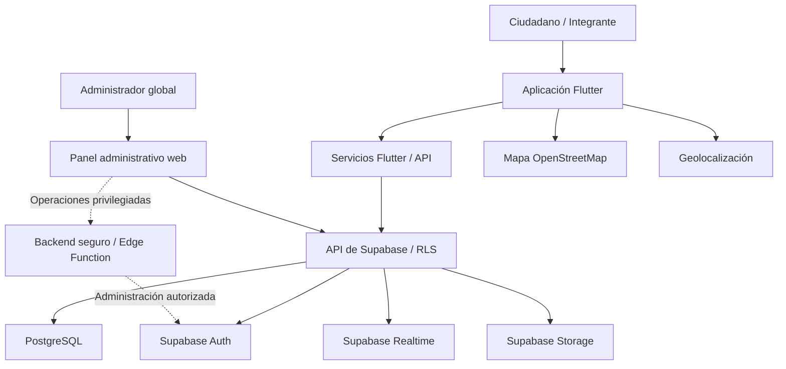
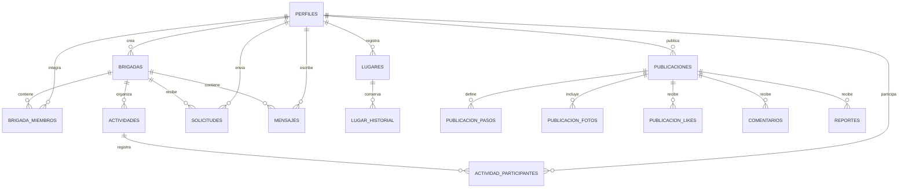

<div align="center">

  

  <h1>EcoBrigada</h1>
  <h3>Plataforma Comunitaria para la Recuperación de Espacios Públicos</h3>

  <p><em>Conectando comunidades para construir espacios públicos más limpios, sostenibles y participativos.</em></p>

  
  
  
  
  
  

  <p><strong>EcoBrigada 3.0 · Proyecto APT / Capstone · Duoc UC, Sede San Andrés de Concepción</strong></p>

</div>

---

## Índice

1. [Descripción del proyecto](#descripción-del-proyecto)
2. [Problemática y propuesta de solución](#problemática-y-propuesta-de-solución)
3. [Alcance geográfico](#alcance-geográfico)
4. [Estado del desarrollo](#estado-del-desarrollo)
5. [Funcionalidades](#funcionalidades)
6. [Panel administrativo web](#panel-administrativo-web)
7. [Roles y permisos](#roles-y-permisos)
8. [Capturas de pantalla](#capturas-de-pantalla)
9. [Tecnologías y dependencias](#tecnologías-y-dependencias)
10. [Arquitectura del sistema](#arquitectura-del-sistema)
11. [Estructura del proyecto](#estructura-del-proyecto)
12. [Modelo de datos](#modelo-de-datos)
13. [Instalación y configuración](#instalación-y-configuración)
14. [Seguridad y trazabilidad](#seguridad-y-trazabilidad)
15. [Pruebas y criterios de aceptación](#pruebas-y-criterios-de-aceptación)
16. [Alcance técnico y limitaciones](#alcance-técnico-y-limitaciones)
17. [Equipo y contribuciones](#equipo-y-contribuciones)
18. [Licencia](#licencia)

---

## Descripción del proyecto

**EcoBrigada 3.0** es una aplicación desarrollada con Flutter, orientada a la participación ciudadana, la recuperación de espacios públicos y la educación ambiental.

Su propósito es facilitar la colaboración entre vecinos y organizaciones comunitarias mediante herramientas de georreferenciación, coordinación de brigadas, comunicación y difusión de prácticas de reciclaje y reutilización.

La aplicación centraliza la información de espacios intervenidos y por intervenir, permite organizar actividades comunitarias y conserva el registro de los cambios realizados.

De esta manera, transforma iniciativas ambientales aisladas en acciones coordinadas y trazables.

> **Estado del proyecto:** MVP académico en desarrollo y validación. Esta documentación describe el alcance previsto y documentado del sistema. La disponibilidad real de cada módulo debe contrastarse con la versión del código que se ejecute.

### Objetivo general

Desarrollar una plataforma digital que impulse la recuperación de espacios públicos mediante el registro de zonas que requieren intervención, la coordinación de brigadas de limpieza, el seguimiento de sus actividades y la difusión de conocimientos sobre reciclaje.

### Objetivos específicos

- Centralizar la información geográfica de zonas sucias, espacios recuperados y actividades comunitarias.
- Facilitar la creación, administración y participación en brigadas de limpieza.
- Registrar los cambios de estado de los lugares intervenidos, identificando al usuario y la fecha de cada acción.
- Promover la participación y el aprendizaje ambiental mediante publicaciones de reciclaje y reutilización.
- Proteger las operaciones y datos del sistema mediante autenticación, autorización y reglas de acceso.
- Proporcionar una solución mantenible y extensible, con separación de responsabilidades y persistencia relacional.
- Facilitar la administración de la plataforma mediante un panel web independiente.

---

## Problemática y propuesta de solución

La acumulación de residuos en espacios públicos afecta la calidad de vida de las comunidades y el entorno.

A menudo, los vecinos desconocen dónde existe una necesidad de limpieza, qué actividades están organizadas o cómo participar.

La coordinación mediante canales informales también dificulta conservar un historial de las actividades realizadas.

EcoBrigada aborda esta problemática mediante cinco ejes:

| Eje | Solución |
| --- | --- |
| Información | Mapa colaborativo con ubicaciones y estados de los espacios públicos. |
| Coordinación | Brigadas, actividades, solicitudes de participación y chat grupal. |
| Trazabilidad | Historial de cambios de estado y registro de decisiones de participación. |
| Educación ambiental | Guías, fotografías y proyectos de reutilización compartidos por la comunidad. |
| Gestión de plataforma | Panel web independiente para administración global y gestión de usuarios. |

---

## Alcance geográfico

El alcance inicial del proyecto APT se concentra en la Región del Biobío, Chile, específicamente en las comunas de:

- Coronel.
- Concepción.
- Lota.
- San Pedro de la Paz.

Estas comunas definen el alcance territorial del piloto académico.

El mapa puede visualizar otras ubicaciones, pero la expansión territorial y la validación en nuevas comunas quedan fuera del alcance inicial.

---

## Estado del desarrollo

EcoBrigada 3.0 comprende una aplicación Flutter y un **panel administrativo web independiente**.

El panel se ha ejecutado en un entorno local. Su integración, permisos y operaciones sensibles deben probarse contra el backend configurado antes de su despliegue público.

| Componente | Estado | Observación |
| --- | --- | --- |
| Aplicación Flutter | MVP en desarrollo | Verificar cada flujo funcional en la versión actual. |
| Backend Supabase | En integración y validación | Revisar tablas, funciones y políticas RLS. |
| Base de datos PostgreSQL | Modelo documentado | Requiere comprobar el esquema actual. |
| Panel administrativo web | Disponible en entorno local | Se ejecuta independientemente de Flutter. |
| Administración de usuarios | En desarrollo | Incluye gestión de permisos globales. |
| Eliminación de cuentas | Requiere validación | Necesita operaciones seguras desde el servidor. |
| Machine Learning | Propuesta futura | No se considera implementado. |

**Importante:** las funcionalidades descritas a continuación representan el comportamiento diseñado o documentado para el MVP. No constituyen evidencia de que todas las pruebas hayan sido completadas.

---

## Funcionalidades

### 1. Autenticación y perfil de usuario

El sistema utiliza **Supabase Auth** para gestionar la autenticación de los usuarios.

Funcionalidades contempladas:

- Registro de usuarios con información personal y credenciales.
- Inicio de sesión mediante correo electrónico y contraseña.
- Cierre de sesión.
- Confirmación del correo cuando esté habilitada en Supabase.
- Creación del perfil asociado a la cuenta.
- Visualización de datos del usuario.
- Consulta de puntos acumulados.
- Consulta del estado de solicitudes de participación.
- Control de acceso a funcionalidades que requieren autenticación.

Los visitantes pueden consultar información pública cuando las políticas del sistema lo permitan.

### 2. Mapa colaborativo y geolocalización

El mapa constituye uno de los módulos principales de EcoBrigada.

Utiliza **OpenStreetMap** y la biblioteca **flutter_map** para representar información georreferenciada.

Funcionalidades:

- Visualización de mapas interactivos.
- Registro de lugares con nombre, descripción y coordenadas.
- Identificación de lugares sucios.
- Identificación de lugares recuperados o limpiados.
- Visualización de actividades de brigadas.
- Marcadores diferenciados según el tipo de información.
- Filtros para seleccionar las categorías visibles.
- Consulta de detalles de cada ubicación.
- Registro y consulta del historial de cambios de estado.
- Obtención de la ubicación del dispositivo con autorización.
- Selección de ubicaciones para actividades comunitarias.
- Actualización del estado de los espacios registrados.

El mapa utiliza mosaicos cartográficos de OpenStreetMap y muestra la atribución correspondiente.

No requiere una clave de Google Maps Platform.

### 3. Brigadas de limpieza

El módulo de brigadas permite organizar grupos comunitarios para desarrollar actividades ambientales.

Entre sus funcionalidades se consideran:

- Creación de brigadas.
- Registro de nombre, descripción y comuna.
- Listado de brigadas disponibles.
- Búsqueda por nombre o comuna.
- Visualización de integrantes.
- Identificación del jefe de brigada.
- Configuración de brigadas abiertas o cerradas a solicitudes.
- Envío de solicitudes de ingreso.
- Aceptación o rechazo de solicitudes.
- Consulta del estado de participación.

El creador de una brigada puede asumir automáticamente su administración, según las reglas implementadas en el backend.

Un usuario puede participar en diferentes brigadas.

### 4. Organización de actividades

Las brigadas pueden organizar actividades destinadas a recuperar espacios públicos.

Cada actividad contempla:

- Título.
- Descripción.
- Fecha de inicio.
- Ubicación geográfica.
- Brigada organizadora.
- Estado de la actividad.
- Registro de participantes.

Los estados considerados son:

- **Programada:** actividad pendiente de realización.
- **En curso:** actividad que se está desarrollando.
- **Finalizada:** actividad concluida.

Los usuarios pueden consultar las actividades y solicitar su participación cuando corresponda.

El jefe de brigada gestiona las solicitudes correspondientes.

### 5. Chat de brigadas en tiempo real

El módulo de comunicación está diseñado para facilitar la coordinación interna.

Funcionalidades contempladas:

- Conversaciones independientes por brigada.
- Acceso restringido a integrantes autorizados.
- Envío de mensajes de texto.
- Identificación del autor.
- Registro de fecha y hora.
- Actualización de mensajes mediante Supabase Realtime.
- Validación de mensajes no vacíos.
- Límite documentado de 2.000 caracteres por mensaje.

La comunicación utiliza los servicios de Supabase y las políticas de acceso configuradas para cada brigada.

### 6. Trazabilidad de espacios públicos

El sistema contempla un historial para registrar la creación y modificación de lugares.

Cada registro incluye:

- Identificador del espacio público.
- Usuario responsable.
- Estado anterior.
- Estado nuevo.
- Fecha y hora del evento.

La actualización del estado está diseñada para ejecutarse mediante una operación SQL que conserva el historial del cambio.

Esto permite consultar la evolución de los lugares intervenidos y evitar modificaciones redundantes cuando el estado no cambia.

### 7. Publicaciones de reciclaje y reutilización

Este módulo está orientado a compartir conocimientos ambientales.

Las publicaciones pueden incluir:

- Título.
- Descripción.
- Materiales necesarios.
- Instrucciones numeradas.
- Fotografías.
- Información del autor.
- Comentarios.
- Reacciones mediante «Me gusta».
- Reportes de contenido inapropiado.

El alcance documentado contempla:

- Hasta 12 pasos por publicación.
- Hasta tres fotografías.
- Límite de 5 MB por fotografía.
- Formatos JPG, JPEG, PNG y WebP.
- Almacenamiento de imágenes en Supabase Storage.
- Persistencia de información en PostgreSQL.

La carga de imágenes y las interacciones deben contar con las validaciones y políticas de seguridad correspondientes.

### 8. Participación y puntos

El modelo contempla un campo de puntos asociado al perfil de cada usuario.

Este componente permitirá ampliar las funcionalidades de participación ciudadana.

Las siguientes características se consideran mejoras futuras:

- Asignación automática de puntos.
- Rankings de participación.
- Insignias ambientales.
- Desafíos comunitarios.
- Recompensas simbólicas por actividades completadas.

La gamificación completa todavía no se considera una funcionalidad implementada.

---

## Panel administrativo web

EcoBrigada 3.0 incorpora un **panel administrativo web independiente** de la aplicación desarrollada en Flutter.

Su propósito es facilitar la administración global de usuarios y los procesos de gestión de la plataforma.

El panel utiliza tecnologías web y se ejecuta localmente en un navegador.

### Funciones del panel administrativo

Las funcionalidades y operaciones contempladas incluyen:

- Consultar usuarios registrados.
- Visualizar información necesaria para la administración.
- Gestionar permisos globales.
- Diferenciar ciudadanos y administradores.
- Iniciar procesos de eliminación de usuarios.
- Controlar el acceso a operaciones administrativas.
- Evitar la exposición innecesaria de información privada.

### Administración de usuarios

La plataforma distingue dos permisos globales:

| Rol | Descripción |
| --- | --- |
| Ciudadano | Usuario que participa en las funcionalidades comunitarias. |
| Administrador | Usuario autorizado para gestionar funciones globales de la plataforma. |

El cargo de **Jefe de brigada** no representa un rol global.

Este permiso está asociado a una brigada específica.

### Eliminación de usuarios

La gestión administrativa contempla la eliminación de usuarios registrados.

Antes de habilitar esta operación en producción, es necesario verificar:

1. Que el solicitante tenga permisos de administrador global.
2. Que la operación requiera confirmación.
3. Que las brigadas administradas por el usuario se reasignen cuando corresponda.
4. Que se defina el tratamiento de sus publicaciones y registros históricos.
5. Que se establezca la política de eliminación o anonimización de información personal.
6. Que la eliminación de Supabase Auth se ejecute desde un servicio seguro.

> **Importante:** las operaciones privilegiadas de Supabase Auth no deben ejecutarse desde JavaScript del navegador utilizando claves administrativas. Deben gestionarse desde un backend seguro, por ejemplo, mediante una Supabase Edge Function con autenticación y autorización.

### Ejecución local del panel

El panel administrativo se mantiene en una carpeta independiente de la aplicación Flutter.

Desde PowerShell, ubicarse en la carpeta que contiene el script de inicio.

Ejecutar:

```powershell
powershell -ExecutionPolicy Bypass -File .\INICIAR_PANEL.ps1
```

Luego abrir:

```text
http://localhost:8081
```

La terminal debe permanecer abierta mientras el panel está en funcionamiento.

Esta dirección corresponde al servidor local y no representa un despliegue público.

---

## Roles y permisos

EcoBrigada diferencia los permisos globales de los permisos asociados a cada brigada.

### Roles globales

| Rol | Alcance |
| --- | --- |
| Ciudadano | Accede a funcionalidades comunitarias según su autenticación y membresías. |
| Administrador | Accede a operaciones globales permitidas por las reglas de seguridad. |

### Roles de brigadas

| Rol | Descripción |
| --- | --- |
| Miembro | Usuario que pertenece a una brigada y participa en sus actividades. |
| Jefe de brigada | Usuario encargado de gestionar una brigada específica. |

### Matriz de permisos comunitarios

| Acción | Visitante | Ciudadano | Miembro | Jefe de brigada |
| --- | :---: | :---: | :---: | :---: |
| Consultar información pública | Sí | Sí | Sí | Sí |
| Registrar lugares | No | Sí | Sí | Sí |
| Cambiar estados de lugares | No | Sí | Sí | Sí |
| Crear brigadas | No | Sí | Sí | Sí |
| Publicar guías ambientales | No | Sí | Sí | Sí |
| Solicitar ingreso a brigadas | No | Sí* | No | No |
| Solicitar participación en actividades | No | Sí* | Sí* | Gestiona* |
| Comentar publicaciones | No | Sí | Sí | Sí |
| Acceder al chat de su brigada | No | No | Sí | Sí |
| Crear actividades de su brigada | No | No | No | Sí |
| Gestionar solicitudes de su brigada | No | No | No | Sí |

\* Sujeto al estado de la brigada o actividad y a las reglas de acceso configuradas.

### Matriz de permisos administrativos

| Operación | Ciudadano | Administrador global |
| --- | :---: | :---: |
| Acceso al panel administrativo | No | Sí |
| Consultar gestión global de usuarios | No | Sí |
| Modificar roles globales autorizados | No | Sí |
| Iniciar eliminación de usuarios | No | Sí, mediante operación segura |
| Gestionar su propia brigada | Según membresía | Según membresía |
| Consultar datos sensibles sin justificación | No | No |

Un mismo usuario puede ser jefe de una brigada y miembro de otra.

Ser jefe de brigada no otorga automáticamente permisos de administrador global.

Los permisos deben comprobarse desde el backend y no depender únicamente de la interfaz.

---

## Capturas de pantalla

En esta sección se incorporarán capturas reales de la aplicación y del panel administrativo.

Las imágenes se almacenarán en:

```text
docs/images/
```

### Imágenes consideradas

| Pantalla | Archivo sugerido |
| --- | --- |
| Inicio | `inicio.png` |
| Inicio de sesión y registro | `autenticacion.png` |
| Mapa colaborativo | `mapa.png` |
| Brigadas y actividades | `brigadas.png` |
| Publicaciones | `publicaciones.png` |
| Perfil | `perfil.png` |
| Panel administrativo | `panel-administrativo.png` |

### Vista previa de la aplicación

<!--
Descomentar este bloque cuando las imágenes
estén disponibles en docs/images/.
-->

<!--
<div align="center">

  

  

  

</div>
-->

### Vista previa del panel administrativo

<!--
<div align="center">

  

</div>
-->

---

## Tecnologías y dependencias

### Stack tecnológico

| Tecnología | Categoría | Uso |
| --- | --- | --- |
| [Flutter](https://flutter.dev/) | Framework | Desarrollo multiplataforma de la aplicación. |
| [Dart](https://dart.dev/) | Lenguaje | Desarrollo de funcionalidades y lógica de la aplicación. |
| Material Design 3 | Diseño | Interfaz, componentes y navegación. |
| HTML | Panel web | Estructura del panel administrativo. |
| CSS | Panel web | Estilos visuales y distribución. |
| JavaScript | Panel web | Interactividad y operaciones del panel. |
| PowerShell | Herramienta | Ejecución local del panel administrativo. |
| [Supabase](https://supabase.com/) | Backend as a Service | Autenticación, almacenamiento, base de datos y servicios. |
| [PostgreSQL](https://www.postgresql.org/) | Base de datos | Persistencia relacional. |
| SQL / PL/pgSQL | Base de datos | Funciones, consultas, restricciones y procedimientos. |
| Supabase Auth | Autenticación | Gestión de usuarios y sesiones. |
| Supabase Realtime | Comunicación | Eventos y mensajería en tiempo real. |
| Supabase Storage | Archivos | Almacenamiento de fotografías. |
| PostgREST | API | Comunicación con PostgreSQL. |
| Row Level Security | Seguridad | Control de acceso a los datos. |
| [OpenStreetMap](https://www.openstreetmap.org/) | Cartografía | Información cartográfica. |
| Git / GitHub | Versionamiento | Control de cambios y colaboración. |
| Android Studio | Desarrollo móvil | Compilación y pruebas Android. |
| Visual Studio Code | IDE | Desarrollo del código. |
| Gradle / Kotlin | Android | Compilación y configuración nativa. |
| Xcode | iOS | Compilación y pruebas desde macOS. |
| StarUML | Diseño técnico | Diagramas UML. |
| drawDB | Modelado | Diseño de entidades y relaciones. |

### Bibliotecas principales de Flutter

Las siguientes versiones proceden de la documentación base y deben compararse con el `pubspec.yaml` de la versión actual.

| Paquete | Versión documentada | Propósito |
| --- | --- | --- |
| [supabase_flutter](https://pub.dev/packages/supabase_flutter) | `^2.18.3` | Conexión con Supabase. |
| [flutter_map](https://pub.dev/packages/flutter_map) | `^8.3.2` | Visualización de mapas. |
| [latlong2](https://pub.dev/packages/latlong2) | `^0.10.1` | Coordenadas geográficas. |
| [geolocator](https://pub.dev/packages/geolocator) | `^14.1.2` | Ubicación del dispositivo. |
| [image_picker](https://pub.dev/packages/image_picker) | `^1.2.4` | Selección de fotografías. |
| [url_launcher](https://pub.dev/packages/url_launcher) | `^6.3.3` | Apertura de enlaces externos. |
| [cupertino_icons](https://pub.dev/packages/cupertino_icons) | `^1.0.8` | Recursos de iconografía. |

### Dependencias indirectas relevantes

Las siguientes versiones corresponden al lockfile documentado previamente. Deben verificarse contra el `pubspec.lock` actual.

| Paquete | Versión base | Responsabilidad |
| --- | --- | --- |
| `supabase` | `2.16.5` | Cliente Dart de Supabase. |
| `gotrue` | `2.27.3` | Autenticación y sesiones. |
| `postgrest` | `2.9.1` | API de base de datos. |
| `realtime_client` | `2.13.2` | Eventos en tiempo real. |
| `storage_client` | `2.8.1` | Almacenamiento. |
| `geolocator_android` | `5.2.1` | Geolocalización Android. |
| `image_picker_android` | `0.8.13+25` | Selección de imágenes Android. |
| `http` | `1.6.0` | Comunicación HTTP. |
| `path_provider` | `2.1.6` | Directorios locales. |
| `web_socket_channel` | `3.0.3` | Comunicación WebSocket. |

### Herramientas de calidad

| Herramienta | Uso |
| --- | --- |
| `flutter_test` | Pruebas unitarias y de widgets. |
| `flutter_lints` | Reglas de análisis estático. |
| `flutter analyze` | Detección de problemas de código. |
| `flutter doctor` | Diagnóstico del entorno. |
| Supabase Dashboard | Administración y verificación de datos. |
| Supabase SQL Editor | Ejecución y revisión de consultas SQL. |

---

## Arquitectura del sistema

EcoBrigada utiliza una arquitectura organizada por capas.

Se compone de:

1. Aplicación Flutter.
2. Panel administrativo web.
3. Servicios de acceso a datos.
4. Backend Supabase.
5. Base de datos PostgreSQL.
6. Servicios de mapas y geolocalización.

### Diagrama de arquitectura



La conexión punteada representa el backend seguro requerido para las operaciones privilegiadas del panel. No confirma que ese servicio ya esté desplegado.

### Descripción de capas

| Capa | Responsabilidad |
| --- | --- |
| Presentación | Pantallas, formularios, navegación y componentes visuales. |
| Administración | Herramientas web para gestión global de la plataforma. |
| Servicios | Consultas, autenticación y comunicación con Supabase. |
| Lógica de servidor | Funciones SQL, políticas, validaciones y autorización. |
| Persistencia | Almacenamiento de registros y archivos. |
| Servicios externos | Cartografía y ubicación geográfica. |

Esta arquitectura facilita el mantenimiento y permite incorporar nuevas funcionalidades progresivamente.

---

## Estructura del proyecto

La estructura documentada de la aplicación Flutter es la siguiente.

Debe contrastarse con los directorios de la versión actual del repositorio.

```text
ecobrigadasupabase/
│
├── android/
│
├── ios/
│
├── lib/
│   │
│   ├── main.dart
│   │
│   ├── pages/
│   │   ├── auth_page.dart
│   │   ├── mapa_page.dart
│   │   ├── brigadas_page.dart
│   │   ├── chat_page.dart
│   │   ├── publicaciones_page.dart
│   │   └── perfil_page.dart
│   │
│   └── services/
│       └── api.dart
│
├── supabase/
│   └── 01_esquema.sql
│
├── analysis_options.yaml
│
├── pubspec.yaml
│
├── pubspec.lock
│
└── README.md
```

### Panel administrativo

El panel administrativo se encuentra en un proyecto independiente.

Su estructura general es:

```text
EcoBrigada_Panel_Admin_Web/
│
├── INICIAR_PANEL.ps1
│
├── src/
│   ├── app.js
│   └── style.css
│
└── index.html
```

La ubicación definitiva dentro del repositorio debe actualizarse cuando se incorpore el panel a GitHub.

---

## Modelo de datos

EcoBrigada utiliza PostgreSQL como sistema de gestión de base de datos.

Las relaciones se organizan mediante claves primarias, claves foráneas, restricciones y funciones SQL.

### Tablas principales

| Módulo | Tablas | Información |
| --- | --- | --- |
| Identidad | `perfiles` | Información de usuarios. |
| Brigadas | `brigadas`, `brigada_miembros` | Grupos comunitarios y membresías. |
| Actividades | `actividades`, `actividad_participantes`, `solicitudes` | Actividades y participación. |
| Comunicación | `mensajes` | Chat entre integrantes. |
| Espacios públicos | `lugares`, `lugar_historial` | Lugares y cambios de estado. |
| Reciclaje | `publicaciones`, `publicacion_pasos`, `publicacion_fotos` | Guías y fotografías. |
| Interacciones | `publicacion_likes`, `comentarios`, `reportes` | Reacciones y reportes. |

### Diagrama de relaciones



Para consultar los atributos, restricciones y relaciones completas se debe revisar el archivo SQL del proyecto y las migraciones posteriores, si existen.

La implementación del rol global y la eliminación de usuarios también deben comprobarse en el esquema actual.

---

## Instalación y configuración

### 1. Requisitos previos

Para ejecutar el proyecto se necesita:

- [Flutter SDK](https://docs.flutter.dev/get-started/install).
- Dart incluido con Flutter.
- [Git](https://git-scm.com/).
- [Android Studio](https://developer.android.com/studio).
- Android SDK.
- [Visual Studio Code](https://code.visualstudio.com/) o Android Studio.
- Un proyecto de [Supabase](https://supabase.com/).
- Conexión a internet.
- Dispositivo Android, emulador o navegador compatible.

La compatibilidad específica de versiones debe comprobarse en el archivo `pubspec.yaml`.

Para compilar en iOS se requiere macOS y Xcode.

### 2. Clonar el repositorio

Abrir una terminal y ejecutar:

```bash
git clone https://github.com/se-quilodranr/App-Eco-Brigada-Capstone.git
```

Ingresar al repositorio:

```bash
cd App-Eco-Brigada-Capstone
```

Acceder a la carpeta Flutter documentada:

```bash
cd "fase 2/Evidencias proyecto/Ecobrigada/ecobrigadasupabase"
```

La ruta debe verificarse si la estructura del repositorio cambió.

### 3. Verificar Flutter

Ejecutar:

```bash
flutter --version
```

Revisar el entorno:

```bash
flutter doctor -v
```

Instalar las dependencias:

```bash
flutter pub get
```

Si es necesario aceptar licencias de Android:

```bash
flutter doctor --android-licenses
```

### 4. Configurar Supabase

Para una instalación nueva:

1. Crear un proyecto en Supabase.
2. Ingresar al SQL Editor.
3. Ejecutar el esquema SQL del proyecto sobre una base de datos nueva.
4. Verificar las tablas.
5. Comprobar las políticas RLS.
6. Verificar las funciones SQL y los disparadores.
7. Configurar Supabase Auth.
8. Revisar Supabase Storage.
9. Habilitar Realtime para las tablas que lo requieran.

> Si ya existe una base de datos configurada, no ejecutar nuevamente el esquema completo sin revisar previamente sus efectos. Utilizar migraciones cuando corresponda.

### 5. Obtener las variables de conexión

Desde Supabase Dashboard, obtener:

| Variable | Descripción |
| --- | --- |
| `SUPABASE_URL` | URL pública del proyecto. |
| `SUPABASE_PUBLISHABLE_KEY` | Clave pública del cliente. |

La conexión se configura mediante variables de compilación utilizadas por Flutter.

Ejemplo:

```bash
--dart-define=SUPABASE_URL="https://TU_PROYECTO.supabase.co"
```

```bash
--dart-define=SUPABASE_PUBLISHABLE_KEY="TU_CLAVE_PUBLICA"
```

La aplicación debe consumir estas variables mediante `String.fromEnvironment` si mantiene la configuración documentada.

**Seguridad:**

- No publicar claves secretas.
- No incluir la clave `service_role` en Flutter.
- No incluir credenciales administrativas en JavaScript.
- Mantener activadas y correctamente configuradas las políticas RLS.
- No considerar la clave Publishable como un mecanismo de autorización.

### 6. Ejecutar la aplicación

Mostrar dispositivos disponibles:

```bash
flutter devices
```

Ejecutar Flutter:

```bash
flutter run -d ID_DISPOSITIVO --dart-define=SUPABASE_URL="https://TU_PROYECTO.supabase.co" --dart-define=SUPABASE_PUBLISHABLE_KEY="TU_CLAVE_PUBLICA"
```

Reemplazar `ID_DISPOSITIVO` por el identificador del dispositivo correspondiente.

Si solo existe un dispositivo disponible, se puede omitir la selección.

### 7. Ejecutar en navegador

Si el proyecto tiene habilitada la plataforma web, utilizar:

```powershell
flutter run -d web-server --web-hostname 127.0.0.1 --web-port 8080 --dart-define=SUPABASE_URL="https://TU_PROYECTO.supabase.co" --dart-define=SUPABASE_PUBLISHABLE_KEY="TU_CLAVE_PUBLICA"
```

Abrir:

```text
http://127.0.0.1:8080
```

Este método permite utilizar un navegador compatible, como Opera o Edge.

La compatibilidad web de las dependencias debe verificarse antes de ejecutar el proyecto.

### 8. Ejecutar el panel administrativo

Abrir una segunda terminal.

Ingresar a la carpeta del panel web.

Ejecutar:

```powershell
powershell -ExecutionPolicy Bypass -File .\INICIAR_PANEL.ps1
```

Abrir:

```text
http://localhost:8081
```

Flutter y el panel administrativo funcionan como aplicaciones independientes.

El inicio de Flutter no inicia automáticamente el panel administrativo.

### 9. Compilar APK de prueba

Ejecutar:

```bash
flutter build apk --debug --dart-define=SUPABASE_URL="https://TU_PROYECTO.supabase.co" --dart-define=SUPABASE_PUBLISHABLE_KEY="TU_CLAVE_PUBLICA"
```

El archivo generado se encuentra normalmente en:

```text
build/app/outputs/flutter-apk/app-debug.apk
```

Para instalarlo en un dispositivo conectado:

```bash
adb install -r build/app/outputs/flutter-apk/app-debug.apk
```

La compilación de depuración es adecuada para pruebas académicas.

La distribución pública requiere configurar una compilación de producción y su firma correspondiente.

### 10. Solución de problemas frecuentes

| Problema | Solución |
| --- | --- |
| Flutter no es reconocido | Verificar la variable PATH. |
| Error de dependencias | Ejecutar `flutter pub get`. |
| Incompatibilidad de Dart | Revisar `flutter --version`. |
| Android no aparece | Revisar USB, controladores y depuración. |
| Error de Supabase | Verificar URL y clave pública. |
| Error de permisos | Revisar autenticación y políticas RLS. |
| El chat no actualiza | Verificar Supabase Realtime. |
| El mapa no obtiene ubicación | Revisar permisos del dispositivo. |
| Error al subir imágenes | Revisar Storage, formatos y políticas. |
| El panel no inicia | Revisar PowerShell, ruta y puerto 8081. |
| Error al eliminar usuario | Revisar permisos y servicio seguro del servidor. |

---

## Seguridad y trazabilidad

EcoBrigada contempla mecanismos de seguridad para proteger la información y las operaciones de la plataforma.

### Autenticación

La autenticación se gestiona mediante Supabase Auth.

Permite identificar a los usuarios que acceden a funcionalidades restringidas.

### Autorización

La base de datos utiliza políticas **Row Level Security (RLS)** para controlar el acceso a los registros.

Los permisos deben verificarse desde el backend.

### Integridad referencial

PostgreSQL permite establecer:

- Claves primarias.
- Claves foráneas.
- Restricciones.
- Relaciones únicas.
- Validaciones de datos.
- Funciones SQL.

### Trazabilidad

El sistema contempla registros asociados a:

- Usuarios responsables.
- Fechas de creación.
- Modificaciones de espacios.
- Estados anteriores y nuevos.
- Solicitudes de participación.
- Decisiones administrativas.

### Almacenamiento

Supabase Storage se utiliza para gestionar las fotografías de publicaciones.

Los archivos deben contar con restricciones de formatos, tamaño y acceso.

### Seguridad del panel administrativo

Las funciones de administración global requieren:

- Identificación del administrador.
- Verificación de permisos.
- Autorización desde un backend seguro.
- Confirmación para operaciones sensibles.
- Protección de credenciales.
- Tratamiento adecuado de información personal.

### Privacidad

El sistema debe minimizar la exposición de información personal.

Las contraseñas no deben mostrarse ni almacenarse en texto plano por la aplicación.

Los datos sensibles deben estar protegidos de acuerdo con las necesidades de cada operación.

Las acciones de eliminación de usuarios requieren una política definida de conservación, anonimización o eliminación de información.

---

## Pruebas y criterios de aceptación

El proyecto considera pruebas funcionales, de integración y de usabilidad.

### Análisis estático

Ejecutar:

```bash
flutter analyze
```

### Pruebas automatizadas

Cuando existan pruebas en el directorio correspondiente:

```bash
flutter test
```

### Casos de prueba

| ID | Caso de prueba | Resultado esperado |
| --- | --- | --- |
| CP-01 | Registro de usuario | Cuenta y perfil creados. |
| CP-02 | Inicio de sesión | Acceso autorizado correctamente. |
| CP-03 | Registro de lugar | Lugar visible en el mapa. |
| CP-04 | Cambio de estado | Estado e historial actualizados. |
| CP-05 | Creación de brigada | Brigada registrada correctamente. |
| CP-06 | Solicitud de ingreso | Solicitud almacenada. |
| CP-07 | Aceptación de solicitud | Membresía registrada. |
| CP-08 | Creación de actividad | Actividad disponible. |
| CP-09 | Chat de brigada | Mensajes recibidos en tiempo real. |
| CP-10 | Publicación ambiental | Guía y fotografías registradas. |
| CP-11 | Interacciones | Comentarios y reacciones persistidos. |
| CP-12 | Seguridad de acceso | Operaciones no autorizadas rechazadas. |
| CP-13 | Acceso al panel web | Solo administradores autorizados pueden gestionar usuarios. |
| CP-14 | Cambio de rol | Permiso actualizado correctamente. |
| CP-15 | Eliminación de usuario | Cuenta eliminada siguiendo las reglas de seguridad. |
| CP-16 | Eliminación de jefe de brigada | Se respetan las reglas de reasignación cuando corresponda. |

**Nota:** esta tabla presenta criterios de aceptación y resultados esperados. No implica que las pruebas se hayan ejecutado satisfactoriamente.

Las evidencias de ejecución deben registrarse durante la validación del proyecto.

---

## Alcance técnico y limitaciones

El proyecto se encuentra orientado a un MVP académico.

### Limitaciones actuales

- El alcance territorial inicial está definido para cuatro comunas del Biobío.
- Las funciones conectadas a Supabase requieren internet.
- La cartografía depende de la disponibilidad del proveedor de mapas.
- La aplicación no cuenta con un funcionamiento completamente offline-first.
- El rendimiento del backend depende de la infraestructura contratada.
- La gamificación completa continúa como mejora futura.
- Las pruebas de seguridad deben ampliarse.
- El panel administrativo requiere validar completamente sus operaciones privilegiadas antes de publicarse.
- Las funcionalidades y versiones deben verificarse frente al código actualizado.

### Mejoras pendientes

- Incorporar notificaciones de actividades cercanas.
- Añadir puntos específicos de reciclaje.
- Registrar fotografías de antes y después.
- Implementar estadísticas ambientales.
- Fortalecer la moderación de publicaciones.
- Mejorar la accesibilidad.
- Implementar mecanismos de gamificación.
- Optimizar consultas de base de datos.
- Incorporar pruebas automatizadas adicionales.
- Preparar el despliegue para producción.

### Machine Learning

Como línea futura de investigación y desarrollo, se considera evaluar la incorporación de **Machine Learning**.

Su propósito sería ayudar a identificar zonas con mayor riesgo de acumulación de residuos.

Para ello, se podrían estudiar variables como:

- Ubicación geográfica.
- Cantidad de reportes.
- Frecuencia de acumulación de residuos.
- Historial de intervenciones.
- Características del sector.
- Datos ambientales y territoriales disponibles.

Los modelos podrían utilizarse para estimar el riesgo de nuevas acumulaciones de residuos y apoyar la planificación de actividades.

La implementación requerirá disponer de datos suficientes, representativos y verificables.

También será necesario definir métricas de evaluación y comprobar la utilidad real de las predicciones.

> **Estado:** funcionalidad propuesta para una etapa futura. No forma parte del MVP implementado.

---

## Equipo y contribuciones

Proyecto desarrollado como parte del **Proyecto APT / Capstone de Ingeniería en Informática de Duoc UC, Sede San Andrés de Concepción**.

### Integrantes

| Integrante | Participación |
| --- | --- |
| Sebastián Quilodrán | Desarrollo del proyecto EcoBrigada. |
| Brayan Cid | Desarrollo del proyecto EcoBrigada. |

### Repositorio

[App-Eco-Brigada-Capstone](https://github.com/se-quilodranr/App-Eco-Brigada-Capstone)

### Contribuciones

Para contribuir al proyecto:

1. Crear una rama de trabajo.
2. Implementar los cambios correspondientes.
3. Mantener la estructura existente.
4. Ejecutar análisis y pruebas.
5. Crear commits descriptivos.
6. Abrir un pull request.
7. Adjuntar evidencia de los cambios realizados.

No se deben publicar credenciales, tokens privados ni información personal en commits o Issues.

---

## Licencia

La licencia del proyecto está pendiente de definición por el equipo.

No se debe asumir una autorización general de uso, modificación o distribución hasta que se incorpore una licencia al repositorio.

### Atribuciones

La cartografía utiliza información de OpenStreetMap.

© [OpenStreetMap contributors](https://www.openstreetmap.org/copyright).

Consultar también la [política de uso de mosaicos de OpenStreetMap](https://operations.osmfoundation.org/policies/tiles/).

---

<div align="center">

  <strong>EcoBrigada · Tecnología al servicio de la comunidad y el medioambiente.</strong>

</div>
